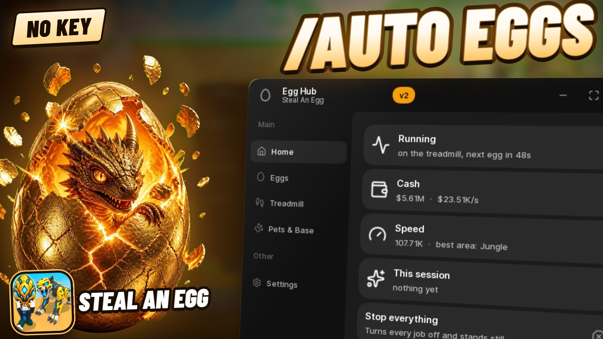

# Egg Hub



An auto farm for **Steal An Egg**. It carries eggs home from the best area your
Speed can handle, hatches them, keeps your best pets in the pen, trains on your
treadmill in between and buys upgrades. Then it keeps doing that, even after the
game moves you to a new server.

## Run it

```lua
loadstring(game:HttpGet("https://raw.githubusercontent.com/robomohit/EggHub/main/egghub.lua"))()
```

Paste that into your executor while you're in Steal An Egg. Open or hide the
window with **Right Ctrl** or the **Egg Hub** button.

Your settings are saved, and the hub queues itself again whenever the game moves
you to a new server. Turn a job on once and it picks up where it left off after a
rejoin. Put the same line in your autoexec folder and it also starts on every
fresh join.

## What it does

**Eggs**
- **Auto eggs:** walks to the nest, takes the biggest egg, and heads home the same
  moment the egg lands in your hands. It places the egg in your pet area and
  hatches it as soon as it's grown.
- **Area:** *Auto* picks the hardest area where you can still outrun the guard. It
  goes by the guard's own escape speed, plus some spare for being slowed while
  carrying. If an area costs you two eggs in a row, it drops to an easier one for
  five minutes. You can also pick an area yourself.
- **Eggs growing at once** and **stop after N pets.**

**Treadmill**
- **Auto treadmill:** stands on your treadmill whenever eggs don't need you, so
  your Speed keeps climbing while eggs grow.
- **Auto upgrade treadmill:** buys the next treadmill tier the moment you can
  afford it.

**Pets & base**
- **Best pets in the pen:** fills empty slots, and swaps a weak pet out whenever
  a better one hatches. Pets are ranked by the game's own earning rate.
- **Auto upgrade base:** buys the next base tier, for more pen slots.

**Other**
- **Claims** your Index rewards and offline earnings.
- **Anti AFK.**
- A live **Home** page: what it's doing, your cash and cash per second, your Speed,
  the best area for you, and what it has hatched this session.

## What it won't do

It doesn't teleport or fly. It walks, the way you would: this game kills or
freezes characters that teleport, tween or go through walls. It never sells
your pets, and it never spends Robux.

## Notes

Automating a Roblox game can get the account banned. Use an account you can
afford to lose.

The published script is obfuscated with Prometheus.
Based on Prometheus by Elias Oelschner, https://github.com/prometheus-lua/Prometheus

## Source

Not published. This repository carries the built script only.
